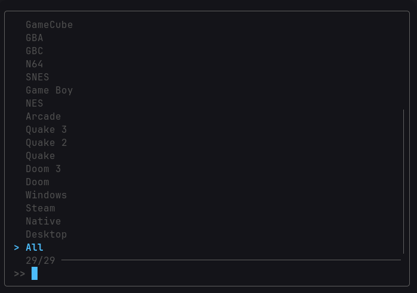

### ngame

ngame is a Bash game launcher that has a LOT of features and functions.

### How It Works

ngame uses its own data folder in `~/nutils-data/ngame` which is where it stores anything it needs, for example:

- Games (`~/nutils-data/ngame/games`)
- Proton Environment(s) (`~/nutils-data/ngame/environments`)
- Portable Emulator Executables (`~/nutils-data/ngame/emulators`)

ngame MAINLY relies on fd to search for games and fzf to display a clean launcher interface.
It also relies on emulators if you want to play retro games. ngame supports these platforms:

- Native
- Steam
- Windows
- Doom
- Doom 3
- Quake
- Quake 2
- Quake 3
- Arcade
- NES
- Game Boy
- SNES
- N64
- GBC
- GBA
- GameCube
- NDS
- Wii
- 3DS
- Wii U
- Switch
- Genesis
- Dreamcast
- PS1
- PS2
- PSP
- PS3

Keep in mind that EACH of these platforms require unique software. Elaboration on that will be in the dependencies section way below.

**Bonus:** fd follows a .fdignore file that ngame sets up so that unnecessary files like save files that get generated in the same folders
as your games don't get included in the interface.

### Usage

ngame has many uses, such as:

- `ngame` - Launches the normal fzf interface to start a game.
- `ngame [Game File Path]` - Launches the game that you specified.
- `ngame [PATH Game Command]` - Launches a game that was installed from native repos (AKA games that you launch with a terminal command).
- `ngame [Steam AppID]` - Launches a Steam game.
- `ngame [Doom 3 Folder Name]` - Launches a Doom 3 folder.
- `ngame [Quake Folder Name]` - Launches a Quake 1 folder.
- `ngame [Quake 2 Folder Name]` - Launches a Quake 2 folder.
- `ngame [Quake 3 Folder Name]` - Launches a Quake 3 folder.
- `ngame [Arcade Game Zip Name]` - Launches an arcade game via its zip file.
- `ngame help/--help/-h` - Shows the CLI help menu.
- `ngame setup` - **CRUCIAL**. Sets up emulators and directories for you.
- `ngame platforms` - Lists all platforms that ngame supports.
- `ngame list` - Lists all the games that ngame detects.
- `ngame move [file(s)]` - Opens an fzf interface to move your selected files (supposedly game files) into whichever platform you need.
- `ngame random` - Picks and runs a random game from the supported list.

Elaboration on `ngame random`'s supported list: It is basically every platform except for Native and Windows.

### Setup

Emulated games reside in `~/nutils-data/ngame/games/emulated`.

Native games reside in `~/nutils-data/ngame/games/native`.

Windows games reside in `~/nutils-data/ngame/games/windows`.

For the best experience in Windows games, install Proton Experimental from Steam.

If you want to play Doom, Doom 3, Quake, Quake 2 or Quake 3 and their mods, you can put their corresponding folders in their respective directories in:

`~/nutils-data/ngame/games/ports`

For most gamers, installing the dependencies will be enough to play games. But, if you want to play:

- NES/Famicom Games
- Genesis/Sega CD Games
- PS1 Games
- PS2 Games
- Switch Games

Then you'll need to provide both BIOS and executable files depending on the platform. For example:

1. NES/Famicom

You'll need to provide the MesenCE executable yourself. You can grab it from:

`https://github.com/nesdev-org/MesenCE/releases`

You'll need to extract it, and move the executable file into `~/nutils-data/ngame/emulators/mesen`,
make sure to name the file simply as `mesen`.

After that, if you want to play exclusive Japanese Famicom games, you have to provide the `disksys.rom` yourself.
Put the file in `~/nutils-data/ngame/emulators/mesen/bios`. Then, in Mesen, go to
Settings > Emulation, click on the Firmwares tab, and hit select on the FDS BIOS path, and point it to the
folder the `disksys.rom` is in.  

2. Genesis/Sega CD

Same process as NES/Famicom, grab the latest build of jgenesis at:

`https://github.com/jsgroth/jgenesis/releases`

And drop the AppImage in `~/nutils-data/ngame/emulators/jgenesis` as `jgenesis.AppImage`.

For Sega CD games, it supports 3 BIOS files:

- `bios_CD_U.bin` - USA
- `bios_CD_E.bin` - Europe
- `bios_CD_J.bin` - Japan

You can provide any one or all if you wish to in `~/nutils-data/ngame/emulators/jgenesis/bios`.
Then, in jgenesis, click Settings > Genesis / Sega CD / 32X, then click the path fields for the regions of the BIOS you want,
and select your BIOS file.

3. PS1

Grab DuckStation's build at:

`https://github.com/stenzek/duckstation/releases`

And drop the AppImage in `~/nutils-data/ngame/emulators/duckstation` as `duckstation.AppImage`

Drop any 3 BIOS files (or all):

- `scph5501.bin` - USA
- `scph5502.bin` - Europe
- `scph5500.bin` - Japan

In `~/nutils-data/ngame/emulators/duckstation/bios`.

4. PS2

PCSX2 has a good AUR package, but for the BIOS:

- `scph39001.bin` - USA
- `SCPH-70004_BIOS_V12_PAL_200.BIN` - Japan
- `scph10000.bin` - Europe

In `~/nutils-data/ngame/emulators/pcsx2/bios`.
Then, in PCSX2, go to Settings > BIOS, hit browse at the top, select the folder the BIOS files are in, and you're set!

5. Switch

Eden needs some manual setup, so here's some help:

- Grab a firmware zip/folder for Eden, and install it by opening the app, then clicking Tools > Install Firmware > From Zip (or From Folder if you got a folder) and choose your firmware.
- From that same Tools drop down, pick Install Decrypted Keys to install your prod.keys file. Repeat for title.keys if you have it.

And you're done!

**Bonus:** Arcade

If you want to play arcade games that requires additional BIOS files, place the BIOS file(s) in `~/nutils-data/ngame/emulators/mame/bios`.

### First Run Experience

When you run ngame for the first time, it will automatically call the setup function to set up directories and configs for you.
After that, it will exit the script to let you load up your library with games.
Once you finish, you can run ngame again, and it will greet you with a clean fzf interface, which looks something like:

From there on, you can start playing!

If you ever need to run the setup process again, just do `ngame setup` in your terminal.

### Dependencies

Here is the FULL dependency list for ngame:

From You:

Read the `Setup` section in this page to find out what you need to provide to have the full ngame experience.

From Pacman/AUR:

- steam (Needed to run Windows games with Proton and, obviously, Steam games.)
- fd
- fzf
- fuse2
- uzdoom
- dhewm3
- ironwail
- yamagi-quake2
- quake3e-git
- mame
- mgba-qt
- snes9x-gtk
- simple64
- dolphin-emu
- melonds
- azahar-appimage-wayland
- cemu-bin
- eden-bin
- flycast-bin
- pcsx2
- ppsspp
- rpcs3-bin

### Compatibility

It should be apparent by now that ngame is also primarily for CachyOS/Arch. The dependencies are all Pacman or AUR packages, and while you CAN install your distro's equivalent,
nothing's guaranteed to work on a different distro.
