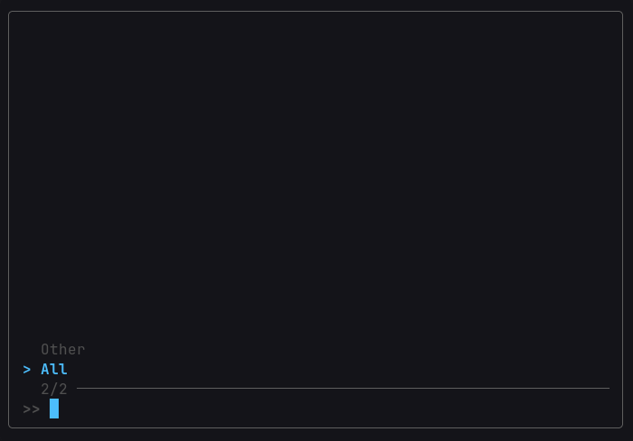

### nmusic

nmusic is a Bash music downloader/player that is pretty easy to use.

### How It Works

nmusic stores and detects music at `~/nutils-data/nmusic`, also known as nmusic's root folder.
It has 2 primary purposes: download your music and play them.

It has a command to download any YouTube song or playlist, and outputs them in an `Other` folder
which is in nmusic's root folder. It treats each folder under its root as playlists, so you have complete
control over what songs are in what playlist. The only exception is nmusic always downloads your songs into the `Other` folder
which shouldn't be much of a problem.

Its main interface is very similar to ngame, it:

- Utilizes fd to both scan your playlists and scan the entire root folder recursively for the "All" option.
- Uses fzf to let you choose either your playlist or browse all songs, and play a single one or all of them.
- Allows you to shuffle your playlist.
- Has an auto-play feature where if you picked a single song, it will automatically shuffle songs after that song ends.

### Usage

nmusic has a few different functions, for example:

- `nmusic` runs the normal fzf interface to play a song.
- `nmusic [.mp3 file]` plays the chosen file.
- `nmusic [folder]` plays the folder (treats it as a playlist).
- `nmusic help/--help/-h` shows the CLI help menu.
- `nmusic download [YouTube Song/Playlist URL]` downloads the YouTube song or playlist of which you provide the URL to.
- `nmusic list` lists all songs that nmusic has detected.

### Setup

If you have any downloaded songs already, just place them in a folder in `~/nutils-data/nmusic` or nmusic's root (which you'll only be able to see when you pick All in the interface).
Make sure your songs are .mp3 files, by the way, nmusic only supports those.

### First Run Experience

It is highly recommended to use `nmusic download` to get your songs first, or at least place them in the location the Setup section above guided you to.
Then, when you run nmusic, you will see a clean fzf interface such as:

Then, you can start listening to your songs!

### Dependencies

nmusic relies on:

- fd
- fzf
- yt-dlp
- mpv

### Compatibility

While this will work on any distro which has the 4 dependencies above, the download function of nmusic only works for YouTube audio.
